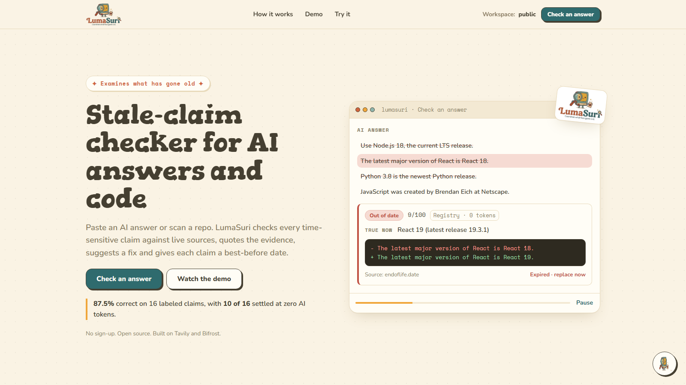
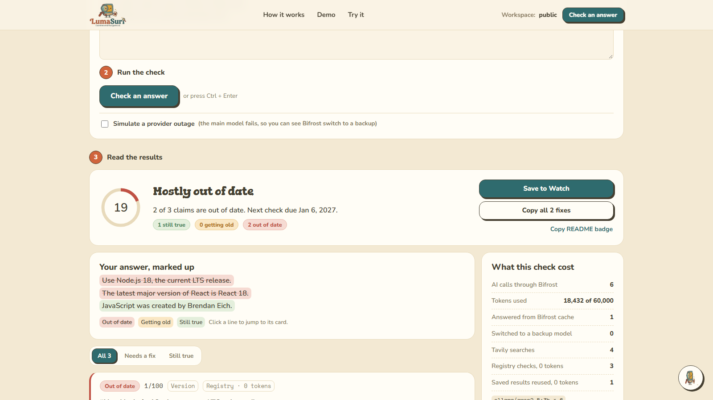
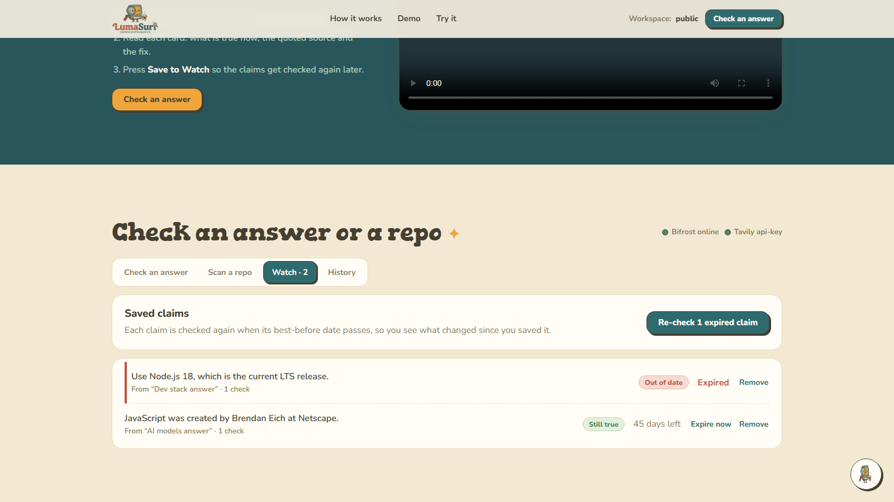
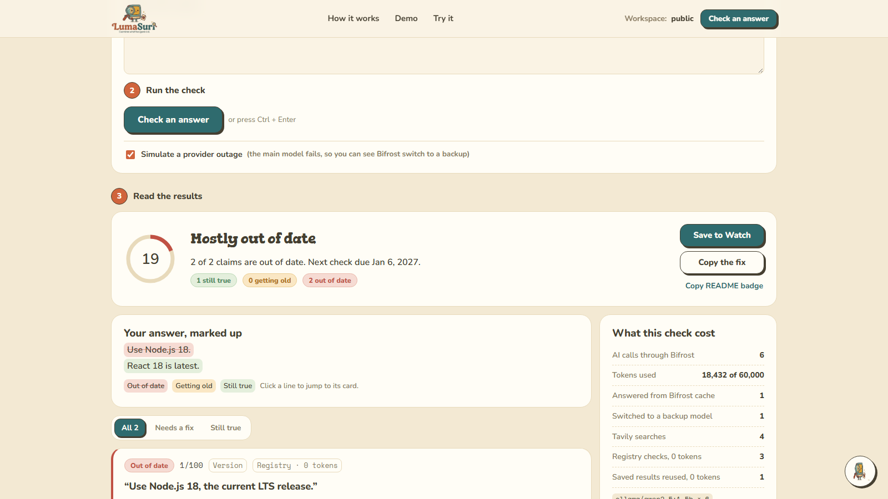
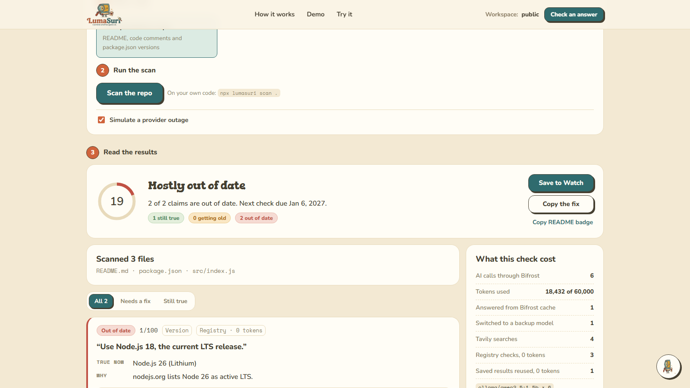
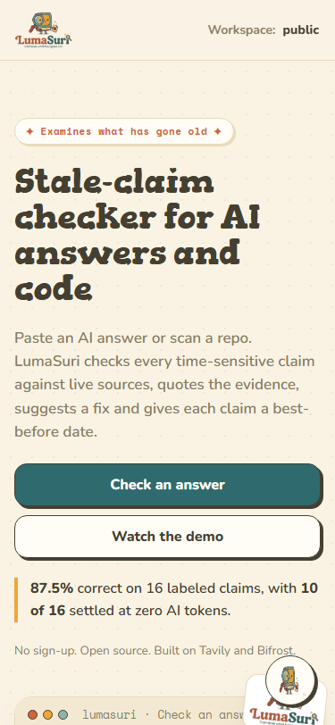
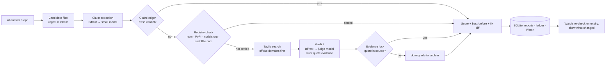

# LumaSuri

**Best-before dates for AI-written claims.**

*Luma* (old) + *suri* (examine): LumaSuri examines what has gone old.

AI assistants answer with whatever was true when they were trained. Those answers get pasted into READMEs, code comments, onboarding docs and support replies, and nobody checks them again. "Node 18 is the current LTS", "use `text-davinci-003`" and "Heroku has a free tier" were all true once.

LumaSuri finds the time-sensitive claims in an AI answer or a whole repository and verifies each one against live sources. Each claim gets three things:

1. a **freshness score** backed by evidence, with the exact source sentence quoted
2. a **best-before date**: when the claim should be checked again, based on how fast that kind of fact changes
3. a **fix diff** when the claim is out of date

Saved claims go into **LumaSuri Watch**. Watch re-verifies them when they expire and shows you what changed since you saved them.

> Built for the **Global AI Hackathon (HackCulture × Geek Room)**, **Problem Statement 06: Build a Stale-Answer Detector for AI Applications**. Uses **Tavily** for live verification and **Bifrost by Maxim AI** as the LLM gateway.

---

## What makes it different

| | Typical "fact-check my answer" tool | LumaSuri |
|---|---|---|
| Input | One chat answer | Chat answers **and whole repos**: README/docs, code comments, `package.json` pins |
| Output | True/false right now | Score plus a **best-before date** taken from the source's real release cadence |
| Over time | Checks once | **Watch** re-checks on expiry and shows what changed |
| Trust | Model's opinion | **Evidence lock**: a verdict counts only if the quoted sentence is really in the fetched source |
| Cost | One LLM call per claim | **Registry first** (npm, PyPI, nodejs.org, endoflife.date, 0 tokens), then Tavily plus an LLM judge only when needed. A **cross-repo claim ledger** reuses verdicts until they expire |
| Fix | "This is wrong" | One-line **fix diff** for the exact file and line |

## Using the web app

Open `http://localhost:3311`. You don't need an account. The home page shows a live example report and a three-step "How a check works" guide, and it has the 2-minute demo video built in.

1. **Paste an AI answer, or pick a sample.** You can also switch to **Scan a repo**.
2. **Press Check an answer** (or Ctrl + Enter).
3. **Read the results.** Each card shows:
   - what is true now
   - the quoted source
   - a fix you can copy
   - a best-before date

   Press **Save to Watch** to have the claims checked again later.

**Workspace (optional).** You can give your workspace a name in the top bar. It needs no account or password. The name keeps your Watch list and history separate from everyone else's, and it is stored only in your browser. If you don't name one, everything goes into the shared `public` workspace.

| Home | Report | Watch |
|---|---|---|
|  |  |  |
|  |  |  |

The UI is styled after the LumaSuri mascot logo: warm cream paper, teal and orange accents, chunky display type (Gorditas) over Nunito and Space Mono, ink-outlined "sticker" buttons, and a floating helper chatbot that explains every feature in plain words.

## Demo results (from this repo)

`node scripts/eval.mjs` runs 16 labeled claims (current and stale). Results with local `qwen2.5:3b` through Bifrost and keyless Tavily:

| Metric | Value |
|---|---|
| Accuracy | **87.5%** (14/16) |
| Resolved by registries (0 tokens) | 10 / 16 |
| LLM calls | 6 (for 16 claims) |
| Tokens | ~12.8k |

Both misses are company/people claims ("Bard", "Twitter CEO") where the small local judge trusted older pages. A stronger verdict model through Bifrost (one env var) is the obvious next step. Full table: [`docs/eval-results.json`](docs/eval-results.json).

Scanning `examples/repos/acme-support-bot` finds 7 stale claims across `README.md`, `package.json` and `src/bot.js` and suggests 7 fixes. It takes 3 LLM calls.

## How it works



### Freshness score

For each claim:

- **S** (support): 1 if supported, 0.5 if unclear, 0 if contradicted
- **R** (recency): `0.5^(age_days / half_life(category))`, using the evidence's publish date
- **A** (authority): 1 for official or registry sources, 0.75 if any official source exists, 0.45 otherwise

With `Q = 0.6R + 0.4A`, the score maps support and confidence into separate bands:

- supported: `60 + 40Q`
- unclear: `30 + 20Q`
- contradicted: `15(1 − Q)`

Score bands: **fresh** is 70 and above, **aging** is 40–69, **stale** is below 40.

### Best-before date

`days = min(category half-life, measured release cadence)`. Unclear verdicts get a third of that. Contradicted claims expire immediately.

Release cadence is the median gap between real releases, from npm/PyPI publish times, the nodejs.org release index or endoflife.date. A package that ships every 14 days gets a 14-day best-before date.

| Category | Half-life |
|---|---|
| version / release | 45 d |
| AI model | 60 d |
| pricing / limits | 60 d |
| API / SDK usage | 90 d |
| company / people | 180 d |
| law / policy | 365 d |

## Sponsor technology

### Tavily: live verification
- `POST /search` with `search_depth: advanced` and `chunks_per_source: 3`. The query is built from the claim, its subject and the current year.
- **Official domains first.** The subject is mapped to vendor docs (`nodejs.org`, `platform.openai.com`, `docs.anthropic.com`, `react.dev`, …) via `include_domains`. If no official result comes back, LumaSuri falls back to an open search.
- The verdict model only sees Tavily's extracted chunks, and it must quote one of them.
- Works with `TAVILY_API_KEY`, or with no key at all (`X-Tavily-Access-Mode: keyless`).

Code: [`src/core/search.js`](src/core/search.js)

### Bifrost: LLM gateway
All model calls go through Bifrost's OpenAI-compatible `/v1/chat/completions` ([`src/core/llm.js`](src/core/llm.js), config in [`bifrost/data/config.json`](bifrost/data/config.json)):

- **Routing per step:** `LUMASURI_EXTRACT_MODEL` (cheap) and `LUMASURI_VERDICT_MODEL` (stronger) can be any provider/model Bifrost supports.
- **Automatic fallback:** every request sends a `fallbacks` list. The **Simulate provider outage** toggle sends the primary call to a dead provider. Bifrost reroutes to the local model, and the UI reads `extra_fields.routing_info.is_fallback` to show the switch.
- **Cache:** the semantic-cache plugin runs in direct mode on Redis, using the `x-bf-cache-key` header. Repeated extractions and verdicts cost 0 tokens. Hits are read from `cache_debug.cache_hit`.
- **Governance:** a virtual key (`x-bf-vk`) with a **daily budget** and a **token rate limit**. On top of that, LumaSuri has its own per-run token cap. When either limit is hit, the remaining claims are marked "not verified (budget)". LumaSuri doesn't overspend and doesn't guess.
- **Observability:** each report shows LLM calls, tokens, cache hits, fallbacks and which model handled each step. The Bifrost dashboard at `http://localhost:8080` has full request logs.

### Guard proxy
LumaSuri also exposes `POST /v1/chat/completions`, a drop-in OpenAI-compatible endpoint. It answers through Bifrost, then attaches a `lumasuri` object with the freshness score and any stale claims and fixes. Point an existing chatbot at it and every answer gets checked.

## Quick start

Requirements: Node.js 20+, Docker, and one of these:
- [Ollama](https://ollama.com) (fully local, free)
- any provider key Bifrost supports

```bash
git clone https://github.com/dioxaaa/lumasuri && cd lumasuri
npm install

# 1. Local models (or skip and configure a cloud provider in bifrost/data/config.json)
ollama pull qwen2.5:3b && ollama pull qwen2.5:1.5b

# 2. Redis (cache) + Bifrost (gateway on :8080)
docker compose up -d

# 3. Web app + API on http://localhost:3311
npm run build && npm start
```

No Docker? On Windows you can run the same stack natively — see `scripts/dev-up.ps1`: it uses the `npx @maximhq/bifrost` binary, a portable Redis build, and your local Ollama install.

Optional environment:

| Variable | Default | Purpose |
|---|---|---|
| `TAVILY_API_KEY` | (keyless) | Higher Tavily limits |
| `LUMASURI_EXTRACT_MODEL` | `ollama/qwen2.5:3b` | Claim-extraction model |
| `LUMASURI_VERDICT_MODEL` | `ollama/qwen2.5:3b` | Judge model, e.g. `openai/gpt-4o-mini` |
| `LUMASURI_FALLBACKS` | `ollama/qwen2.5:3b,ollama/qwen2.5:1.5b` | Bifrost fallback chain |
| `LUMASURI_MAX_TOKENS_PER_RUN` | `60000` | Per-run token cap |
| `BIFROST_URL` / `BIFROST_VIRTUAL_KEY` | `http://127.0.0.1:8080` / `sk-bf-lumasuri-dev` | Gateway |
| `LUMASURI_AUTO_WATCH` | off | `1` re-checks expired Watch items every minute |

To use a cloud provider, add it under `providers` in `bifrost/data/config.json` (see the [Bifrost provider docs](https://docs.getbifrost.ai/)). Then set, for example, `LUMASURI_VERDICT_MODEL=openai/gpt-4o-mini`.

## CLI

```bash
npx lumasuri check answer.md            # or: pbpaste | npx lumasuri check
npx lumasuri scan .                     # README/docs, code comments, package.json
npx lumasuri scan . --fail-under 60     # CI gate: exit 1 if the repo is stale
npx lumasuri scan . --outage            # demo Bifrost failover
npx lumasuri check answer.md --watch    # save claims to Watch
npx lumasuri watch                      # re-check everything past its best-before date
```

## API

| Method | Path | |
|---|---|---|
| POST | `/api/check` | `{ text, simulateOutage?, watch? }`: check an answer |
| POST | `/api/scan` | `{ repo }`: scan an example repo |
| GET | `/api/reports/:id` | Report JSON |
| GET | `/badge/:id.svg` | README freshness badge |
| GET/POST | `/api/watch`, `/api/watch/run` | Watch list / re-check expired items |
| POST | `/v1/chat/completions` | Guard proxy (OpenAI-compatible) |

## Project layout

```
src/core/      pipeline, extraction, registry checks, Tavily, verdict + evidence lock, scoring
src/store.js   SQLite reports, claim ledger, Watch
src/server.js  Express API, guard proxy, badge
bin/           CLI
web/           React (Vite) UI
bifrost/       Bifrost gateway config
examples/      demo answers, demo repo, labeled eval set
test/          node:test unit + pipeline tests (npm test)
docs/          pitch deck, architecture, eval results
```

## Scalability

- Most version claims never reach an LLM, because registry checks run first.
- The claim ledger is keyed by a normalized claim hash. When 1,000 repos say "Node 18 is LTS", the claim is verified once and reused until its best-before date.
- Bifrost adds provider failover, caching and budgets without code changes. Switching from local Ollama to cloud models is a config change.
- The CLI exit code (`--fail-under`) makes it a CI check today. A GitHub Action that comments fix diffs on PRs is the next step.

## Responsible use

- Verdicts are only as good as the sources. LumaSuri shows its evidence so a human can check it.
- When it can't confirm a quote, it says **unclear** instead of guessing.
- It never edits files itself. Fixes are shown as diffs for you to apply.

## Privacy and security

- **No cookies, accounts or tracking.** The optional "workspace" is just a name stored in your browser's `localStorage` and sent as an `x-lumasuri-workspace` header. It separates history and Watch lists — it is not authentication, so use it for organization, not secrecy.
- **Keys never reach the browser.** `TAVILY_API_KEY` and `BIFROST_VIRTUAL_KEY` are read server-side only. `/api/health` reports whether a Tavily key is configured, never the key.
- **What leaves the machine:** extracted claim text goes to the LLM providers configured in Bifrost, and search queries go to Tavily. With local Ollama models, only the Tavily searches leave your network.
- **Data stays local.** Reports and Watch lists live in `data/lumasuri.db` (gitignored). Delete the file to wipe everything.
- **API hardening:** zod-validated request bodies, a 40 KB answer cap, per-IP rate limits on the spend-incurring endpoints (`/api/check`, `/api/scan`, `/api/watch/run`, `/v1/chat/completions`), parameterized SQL throughout, http(s)-only evidence links, workspace-scoped report and Watch access, repo scans confined to `examples/repos/`, and CSP/frame/referrer security headers on every response. The README badge endpoint is intentionally public by report ID — it exposes only the freshness score.
- **Found a problem?** Please open a private issue or contact [@dioxaaa](https://github.com/dioxaaa) rather than posting exploit details publicly.

## Built with

Node.js, Express, React + Vite, SQLite (better-sqlite3), Tavily, Bifrost by Maxim AI, Redis, Ollama (Qwen 2.5).

AI tools used during development: Devin (Cognition) helped with coding, the README and the pitch materials. All design decisions and the submission are by the author, ([@dioxaaa](https://github.com/dioxaaa)), who entered as an individual participant.

## License

MIT
